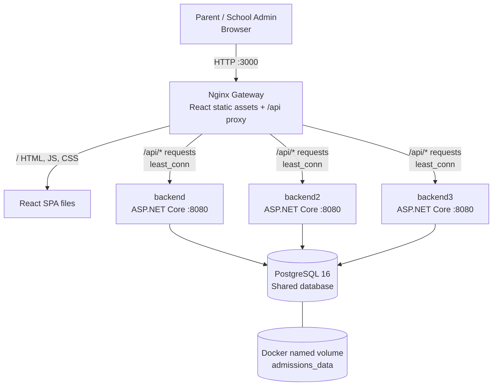

# School Admission System

**A Dockerized, concurrency-aware school admission application** built with ASP.NET Core, PostgreSQL, React, and Nginx.

> **Project type:** Assistant Software Engineer take-home assignment  
> **Implementation:** .NET 10 · PostgreSQL 16 · React 18 · TypeScript · Vite · Nginx · Docker Compose  
> **Status:** Local development / assignment demonstration. Not certified for production deployment.

## Overview

The School Admission System allows a school administrator to configure admission classes and parents or guardians to reserve seats on a first-come, first-served basis. Each class/shift has a fixed capacity. An application initially reserves a seat for a limited period; confirming the simulated payment finalizes admission, while cancellation or expiry releases the seat.

Seat allocation is coordinated in PostgreSQL so concurrent requests against multiple API instances share a single source of truth. **No overselling is the intended invariant; strict network-arrival ordering is not guaranteed.**

### Key capabilities

- Create class/shift offerings and view total, held, confirmed, and available seats.
- Place a time-limited seat hold using a 17-digit student birth-registration identifier.
- Confirm simulated admission payment or cancel an active hold.
- Expire unconfirmed holds and return their seats to availability.
- View a student's holds and their statuses, including after page refresh.
- Present expiry countdowns and periodically refresh capacity information in the React UI.
- Route API requests through Nginx to three ASP.NET Core replicas.
- Use PostgreSQL transactions and row-level locks to protect seat allocation.
- Persist database data through container restarts using a named Docker volume.

## Technology stack

| Layer | Technology |
| --- | --- |
| Frontend | React 18, TypeScript, Vite |
| Backend | ASP.NET Core (.NET 10), C#, Npgsql |
| Database | PostgreSQL 16 |
| Edge gateway | Nginx (static frontend, `/api/` proxy and request limiting) |
| Orchestration | Docker Compose |
| Verification utilities | Python tests; optional Playwright and k6 tooling |

## Architecture and load balancing

The Docker Compose deployment runs **one Nginx gateway**, **three ASP.NET Core API replicas**, and **one persistent PostgreSQL database**. The frontend and reverse proxy share the Nginx container; there is no separate load-balancer appliance or service.

### Request flow



```text
                        Browser / Client
                       http://localhost:3000
                               |
                               v
                +-----------------------------+
                | NGINX GATEWAY (frontend)    |
                | React static files          |
                | /api/* reverse proxy        |
                | IP-based mutation rate limit|
                | least_conn load balancing   |
                +--------------+--------------+
                               |
                  +------------+------------+
                  |            |            |
                  v            v            v
            +-----------+ +-----------+ +-----------+
            | backend   | | backend2  | | backend3  |
            | .NET :8080| | .NET :8080| | .NET :8080|
            +-----+-----+ +-----+-----+ +-----+-----+
                  |            |            |
                  +------------+------------+
                               |
                               v
                     +-----------------+
                     | PostgreSQL 16   |
                     | Shared state    |
                     +--------+--------+
                              |
                     admissions_data volume
```

| Layer | Service | Host exposure | Responsibility |
| --- | --- | --- | --- |
| Entry point | `frontend` (Nginx) | `localhost:3000` by default | Serves React, rate-limits mutations, forwards `/api/` |
| API replica 1 | `backend` | `127.0.0.1:8080` by default | REST API; direct host access is available for diagnostics |
| API replica 2 | `backend2` | Internal Docker network only | Handles proxied API requests |
| API replica 3 | `backend3` | Internal Docker network only | Handles proxied API requests |
| Database | `db` (PostgreSQL 16) | Internal Docker network only | Authoritative admission, hold and seat data |

**Request example:** `GET http://localhost:3000/api/classes` arrives at Nginx; the `proxy_pass http://admission_cluster/` directive removes `/api/`, then sends `GET /classes` to one of the three backend instances. All three use the same PostgreSQL service (`db:5432`). Visiting `http://127.0.0.1:8080/classes` reaches the first API directly and **bypasses** Nginx rate limiting and load balancing.

### Nginx upstream configuration (from `frontend/nginx.conf`)

```nginx
upstream admission_cluster {
    least_conn;
    server backend:8080 max_fails=2 fail_timeout=10s;
    server backend2:8080 max_fails=2 fail_timeout=10s;
    server backend3:8080 max_fails=2 fail_timeout=10s;
}

location /api/ {
    limit_req zone=admission_mutations burst=20 nodelay;
    limit_req_status 429;
    proxy_pass http://admission_cluster/;
    proxy_http_version 1.1;
    proxy_connect_timeout 3s;
    proxy_read_timeout 15s;
    proxy_next_upstream error timeout http_502 http_503;
    proxy_next_upstream_tries 3;
}
```

This is an **excerpt**, not a replacement for the full configuration (which also defines the rate-limit zone, error formatting and forwarded headers).

**Why `least_conn`?** Nginx normally selects an upstream with the fewest active connections (accounting for configured weights). It can help when API request durations vary. It **does not guarantee** that exactly one third of requests go to each replica, nor does it guarantee lower latency or greater total throughput without measurement.

**Failure handling:** `max_fails=2 fail_timeout=10s` enables passive failure tracking. If Nginx sees the configured number of qualifying unsuccessful upstream attempts within the window, it can temporarily avoid the affected peer. This is not an active health-probe system. With `proxy_next_upstream`, an unsuccessful attempt can be sent to another peer **only if Nginx has not already sent the request to that peer in a way that prevents safe retry**; do not assume mutation requests are replayed after being sent. For `POST` and `DELETE`, inspect the actual hold state before a manual retry if the result is uncertain.

### Why the shared database matters

Nginx balances **HTTP requests**, not admission seats. Each backend is a separate ASP.NET Core process, so an in-memory counter would not keep reservations consistent across replicas. PostgreSQL is the shared source of truth; the application uses transactions and row-level locking to coordinate competing holds. The intended invariant is:

```text
active HELD seats + CONFIRMED seats <= totalSeats
```

For example, if a class has one seat left and two simultaneous hold requests reach different replicas, the database transaction/locking behavior must allow at most one successful reservation. This is an **implementation requirement**, not proof of a passing concurrency test; verify with the supplied concurrency tests.

### Rate limiting and overload protection

The Nginx configuration defines `10r/s` per observed client IP for selected mutation endpoints with `burst=20 nodelay`. The configured routes are class creation, seat hold, confirmation and cancellation. Requests exceeding the limit receive HTTP **429** with a JSON error body and `Retry-After: 1`. Ordinary GET requests are not part of this mutation-specific gateway limit. Since different users may share a NAT/public IP, they may also share the same rate-limit bucket. Each API process additionally has its own process-local concurrency limiter; the limit is **not globally shared** across replicas.

### Verify the load balancer (Windows PowerShell)

Run these commands from the repository root **after the frontend startup issue has been fixed**:

```powershell
# All five services should be Up; the database should be healthy.
docker compose ps

# Check the actual Nginx upstream and proxy directives.
docker compose exec frontend nginx -T

# Verify that the gateway can reach at least one API instance.
curl.exe -i http://localhost:3000/api/readyz
curl.exe -i http://localhost:3000/api/classes

# Confirm that all three API services exist.
docker compose ps backend backend2 backend3
```

A `200` from the gateway demonstrates a working request path but **does not prove traffic distribution across three replicas**. For that, inspect instance-level request telemetry or temporarily add a diagnostic response header identifying the serving replica in a non-production environment; then send multiple gateway requests and confirm responses originate from multiple replicas.

To test a **single replica outage**, use the following commands on a disposable development instance. The second command deliberately stops `backend2`, so do not run this during a real admission session:

```powershell
# Simulate one failed replica.
docker compose stop backend2

# Nginx should still be able to serve API requests from the other replicas.
curl.exe -i http://localhost:3000/api/readyz
curl.exe -i http://localhost:3000/api/classes

# Restore the replica.
docker compose start backend2
docker compose ps
```

For automated fault-injection checks, review `tests/failover_test.py` before running it. A single successful request during an outage does not establish comprehensive failover behavior; check repeated requests and error rates.

### Scope and limitations

- **Load balancing is not full high availability.** Nginx and PostgreSQL are single points of failure in this Compose setup.
- The three API replicas share **one Docker host and one database**; a host-wide failure stops the deployment.
- Nginx's passive failure handling does not replace end-to-end health checking, monitoring or a production failover design.
- An API `200` or a successful Docker build alone does not demonstrate fairness, throughput, concurrency correctness or a successful recovery test.

See [load and HA plan](docs/LOAD_AND_HA_PLAN.md), [architecture decisions](docs/ARCHITECTURE_DECISIONS.md), and [operations runbook](docs/OPERATIONS_RUNBOOK.md).

## Quick start

### Prerequisites

- Docker Desktop with Linux containers enabled (Windows/macOS), or Docker Engine and Docker Compose v2 (Linux).
- Git to clone the repository.
- Internet connectivity for initial Docker image and package downloads.

**Node.js, .NET SDK, and PostgreSQL do not need to be installed on the host** to run the application through Docker Compose. Python, Node.js, Playwright, or k6 are only needed for tests run directly on the host.

### 1. Clone the project

```powershell
git clone https://github.com/mdtawhidmostafa/School-Admission-System.git
cd School-Admission-System
```

### 2. Configure the environment

Create a file called `.env` in the repository root. If the checkout includes `.env.example`, copy it first; otherwise create `.env` manually with these development-only values:

```dotenv
POSTGRES_DB=admissions
POSTGRES_USER=admissions
POSTGRES_PASSWORD=REPLACE_WITH_A_UNIQUE_LOCAL_PASSWORD
AUTH_MODE=assignment
ADMIN_API_KEY=
HOLD_DURATION_SECONDS=600
FRONTEND_PORT=3000
BACKEND_PORT=8080
```

Replace the placeholder password before starting. **Do not commit `.env` or copy credentials into issues, logs, or screenshots.** The supplied ZIP snapshot contained `.env` but did **not** contain `.env.example` or `.gitignore`; check your actual Git checkout and add a sanitized `.env.example` and appropriate `.gitignore` before submission.

### 3. Validate and start

```powershell
docker compose config --quiet
docker compose up --build -d
docker compose ps
```

Expected services: `db`, `backend`, `backend2`, `backend3`, and `frontend`. The database should become healthy; the frontend should remain up rather than repeatedly restarting.

### 4. Open the application

| Service | Local address | Notes |
| --- | --- | --- |
| Frontend | http://localhost:3000 | School admin and student/guardian UI |
| Gateway API | http://localhost:3000/api/classes | Requests distributed across API replicas |
| Gateway readiness | http://localhost:3000/api/readyz | Backend readiness through Nginx |
| Direct backend | http://localhost:8080 | First backend instance only |
| Direct readiness | http://localhost:8080/readyz | Expected response: `{"status":"ready"}` |
| Database | `db:5432` | Internal Docker network; not host-exposed by default |

**PowerShell smoke checks:**

```powershell
curl.exe -i http://localhost:8080/readyz
curl.exe -i http://localhost:3000/
curl.exe -i http://localhost:3000/api/classes
```

The `readyz` endpoint should return HTTP 200 with `{"status":"ready"}` once the database is available.

## User workflow

1. **Administrator:** Create an admission class such as `Class 6 - Morning Shift`, specifying its seat capacity.
2. **Student/guardian:** Enter a 17-digit birth registration number in the UI and view available classes.
3. **Reserve:** Select a class to create a temporary seat hold (`HELD`).
4. **Confirm or cancel:** Confirm simulated fee payment before the expiry deadline (`CONFIRMED`), or cancel an active reservation (`CANCELLED`).
5. **Expire:** If not confirmed in time, the reservation becomes `EXPIRED` and its seat returns to available capacity.

Default hold lifetime: **600 seconds (10 minutes)** via `HOLD_DURATION_SECONDS`.

| State | Meaning |
| --- | --- |
| `HELD` | Seat reserved until the expiry deadline |
| `CONFIRMED` | Admission confirmed; counts against capacity |
| `EXPIRED` | Reservation deadline passed |
| `CANCELLED` | Active hold cancelled |

A student cannot maintain more than one active or confirmed admission for the same class. Confirmation of an already confirmed hold is designed to be idempotent. Actual money is **not** transferred: the confirmation action simulates successful payment as permitted by the assignment.

## API reference

Use `http://localhost:8080` for direct backend access or prefix every route with `/api` on `http://localhost:3000` to access it through Nginx.

| Method | Backend route | Purpose |
| --- | --- | --- |
| `GET` | `/healthz` | Liveness |
| `GET` | `/readyz` | Readiness and database check |
| `POST` | `/classes` | Create a class |
| `GET` | `/classes` | List classes and seat counts |
| `GET` | `/classes/{classId}` | Get class details |
| `POST` | `/classes/{classId}/holds` | Reserve a seat |
| `GET` | `/holds/{holdId}` | Get hold status |
| `POST` | `/holds/{holdId}/confirm` | Confirm a hold |
| `DELETE` | `/holds/{holdId}` | Cancel a hold |
| `GET` | `/me/holds` | List holds for a student |
| `GET` | `/admin/auth-check` | Check administrator authorization configuration |

Student-specific calls use the header `X-Student-Id` with exactly **17 digits**. These headers identify the assignment's demo student but do not authenticate a real person.

### Example: create and list classes (PowerShell)

```powershell
$body = @{ name = 'Class 6 - Morning Shift'; totalSeats = 120 } | ConvertTo-Json
Invoke-RestMethod -Method Post -Uri 'http://localhost:8080/classes' -ContentType 'application/json' -Body $body
Invoke-RestMethod -Uri 'http://localhost:8080/classes'
```

When `AUTH_MODE=protected`, the class-creation request also requires a valid `X-Admin-Key` header. The default `assignment` mode intentionally follows the no-login assignment workflow.

### Example: reserve, inspect, confirm

Replace `<CLASS_ID>` and `<HOLD_ID>` with values returned by the API:

```powershell
$studentHeaders = @{ 'X-Student-Id' = '20152691234567890' }
Invoke-RestMethod -Method Post -Uri 'http://localhost:8080/classes/<CLASS_ID>/holds' -Headers $studentHeaders
Invoke-RestMethod -Uri 'http://localhost:8080/holds/<HOLD_ID>'
Invoke-RestMethod -Method Post -Uri 'http://localhost:8080/holds/<HOLD_ID>/confirm' -Headers $studentHeaders
Invoke-RestMethod -Uri 'http://localhost:8080/me/holds' -Headers $studentHeaders
```

Use only fictitious identifiers in development and testing.

## Database access and persistence

```powershell
docker compose exec db pg_isready -U admissions -d admissions
docker compose exec db psql -U admissions -d admissions
```

Useful `psql` commands:

```sql
\dt
SELECT * FROM classes LIMIT 10;
SELECT * FROM holds LIMIT 10;
\q
```

For pgAdmin or DBeaver access, add the following **to the `db` service** in `docker-compose.yml`:

```yaml
ports:
  - "127.0.0.1:5433:5432"
```

Then apply the Compose change and connect to `127.0.0.1:5433` using `POSTGRES_DB`, `POSTGRES_USER`, and `POSTGRES_PASSWORD` from `.env`. Keep the database bound to loopback, not a public interface.

The named volume `admissions_data` persists across a normal `docker compose down` followed by `docker compose up -d`. **Never run `docker compose down -v` unless intentionally deleting the database.**

## Configuration

| Variable | Development default | Purpose |
| --- | --- | --- |
| `POSTGRES_DB` | `admissions` | Database name |
| `POSTGRES_USER` | `admissions` | Database username |
| `POSTGRES_PASSWORD` | Required | Database password (use a unique local value) |
| `HOLD_DURATION_SECONDS` | `600` | Hold expiry duration |
| `AUTH_MODE` | `assignment` | Assignment workflow or optional `protected` mode |
| `ADMIN_API_KEY` | Empty | Required for admin class creation in `protected` mode |
| `FRONTEND_PORT` | `3000` | Host frontend port |
| `BACKEND_PORT` | `8080` | Host direct backend port |
| `TEST_HOLD_SECONDS` | `0` | Optional isolated QA expiry test setting |

`API_BASE_URL` is configured as `/api` for the frontend service in Compose; Nginx forwards those requests internally. The backend `DATABASE_URL` is assembled by Compose using the database settings.

## Additional concurrency and gateway notes

- PostgreSQL transactions and row-level locking serialize competing seat mutations for a given class; active holds plus confirmed admissions must never exceed `totalSeats`.
- The gateway currently uses `least_conn` across three backend replicas.
- Mutation endpoints are limited by observed client IP (10 requests/second with a burst of 20); overloaded clients may receive HTTP 429 and `Retry-After: 1`.
- The backend also applies a per-process concurrency limiter. This does not guarantee a particular throughput or latency.
- Shared public/NAT IPs may cause unrelated users to share the same gateway limit.
- Some failures can leave the outcome of a submitted mutation uncertain; inspect current holds before blindly retrying.
- A single Nginx gateway and a single PostgreSQL instance are **not a high-availability architecture**.

See [architecture decisions](docs/ARCHITECTURE_DECISIONS.md), [load and HA plan](docs/LOAD_AND_HA_PLAN.md), and [operations runbook](docs/OPERATIONS_RUNBOOK.md).

## Testing

Only run mutating, concurrency, and load tests against a disposable test database. The repository provides test scripts, but their existence does **not** establish that they passed on your machine.

```powershell
# Source/configuration checks (requires Python installed locally)
python tests/quality_gate.py

# API integration suite inside Docker, on the currently configured database
# Prefer a disposable QA project/database for this mutating test.
docker compose --profile qa run --rm qa
```

Additional tests are available under `tests/`, including integration/concurrency, gateway policy, failover, persistence, load smoke, browser E2E, and isolated QA utilities. Consult [QA test matrix](docs/QA_TEST_MATRIX.md), [QA report](docs/QA_REPORT.md), and [submission gate](docs/SUBMISSION_GATE.md).

**Evidence note:** The supplied ZIP includes historical QA documentation with unresolved blockers. The later Windows log shows that Docker images built successfully and the direct backend returned HTTP 200 on `/readyz`, but the frontend repeatedly exited during startup. Full end-to-end, concurrency, failover, and persistence results have not been established by those logs. Update QA evidence after running the checks.

## Troubleshooting

### Frontend repeatedly restarts with exit code 127

Observed in the provided Windows startup logs:

```text
/docker-entrypoint.sh: line 31: /docker-entrypoint.d/40-app-config.sh: not found
```

The `frontend/Dockerfile` copies `frontend/entrypoint.sh` into the Nginx initialization directory. A likely cause on Windows is a CRLF line ending in the shell script. Normalize it to Unix LF **inside the Docker build** by replacing its existing chmod instruction with:

```dockerfile
RUN sed -i 's/\r$//' /docker-entrypoint.d/40-app-config.sh \
    && chmod +x /docker-entrypoint.d/40-app-config.sh
```

Then rebuild only the frontend:

```powershell
docker compose build --no-cache frontend
docker compose up -d --no-deps --force-recreate frontend
docker compose ps
docker compose logs --tail=50 frontend
```

If it still fails, inspect the container logs and check that the entrypoint is executable and its interpreter exists. This fix was proposed from log evidence; it is **not yet verified** on the user's runtime.

### Other common issues

| Symptom | Check |
| --- | --- |
| `localhost:3000` refuses connection | `docker compose ps -a`; frontend logs and published port |
| `localhost:8080/readyz` fails | Backend logs, PostgreSQL health and connection settings |
| Nginx returns 502 | Check `backend`, `backend2`, and `backend3` logs |
| API returns 429 | Slow down mutations; honor `Retry-After` |
| Hold returns 409 | Capacity, duplicate reservation, or state conflict |
| Confirm/cancel returns 403 | Check `X-Student-Id` ownership |
| `npm ci` fails | Check corresponding `package-lock.json` validity |
| Port conflict | Change `FRONTEND_PORT` / `BACKEND_PORT` in `.env` |
| Data seems missing | Check current Compose project and named database volume |

## Useful Docker commands

```powershell
docker compose ps                      # Service status
docker compose logs -f frontend       # Follow frontend logs
docker compose logs --tail=100 db     # Database logs
docker compose stop                   # Stop, keep containers and volume
docker compose start                  # Restart stopped containers
docker compose down                   # Remove containers/network, keep DB volume
docker compose up -d                  # Recreate/start as needed
```

## Repository structure

```text
School-Admission-System/
├── backend/                  # ASP.NET Core API and Dockerfile
├── frontend/                 # React UI, Vite, Nginx config, startup script
├── tests/                    # API, concurrency, load and browser testing utilities
├── docs/                     # Assumptions, decisions, QA and operational documentation
├── deploy/                   # Alternative deployment configuration
├── ops/                      # Backup/restore support
├── scripts/                  # Developer setup utilities
├── docker-compose.yml
└── README.md
```

## Assignment documentation

- [Assumptions and rationale](docs/ASSUMPTIONS.md)
- [AI usage disclosure](docs/AI_USAGE.md)
- [Requirements traceability](docs/REQUIREMENTS_TRACEABILITY.md)
- [Reviewer guide](docs/REVIEWER_GUIDE.md)
- [QA report](docs/QA_REPORT.md)
- [Submission gate](docs/SUBMISSION_GATE.md)

## Security and release notes

`AUTH_MODE=assignment` is deliberately a demonstration workflow: a client-provided `X-Student-Id` is **not** verified identity or secure authentication. The optional administrator key does not replace user authentication and role-based access control. Do not deploy for real admissions without security design, migrations, secrets management, HTTPS, backup/recovery verification, monitoring, and production testing.

No license was identified in the supplied ZIP snapshot. Unless a license is explicitly added, do not assume third parties have permission to reuse or redistribute the source.
